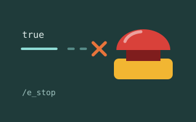

# Blog

What I tried on Caretta, what worked and what didn't.

<div class="fsr-posts">
<a class="fsr-post-row" href="e-stop-once">
  <span class="fsr-post-row__cover"></span>
  <span class="fsr-post-row__body">
    <span class="fsr-post-row__tags"><span>ROS 2</span><span>twist_mux</span></span>
    <span class="fsr-post-row__title">Why twist_mux missed my e-stop</span>
    <span class="fsr-post-row__text">A single message should block the robot. On a busy computer, it failed 7 times out of 20.</span>
    <span class="fsr-post-row__foot"><span>25 Nov 2026 · 2 min read</span><span class="fsr-post-row__more">Read →</span></span>
  </span>
</a>
</div>

```{toctree}
:hidden:

e-stop-once
```
