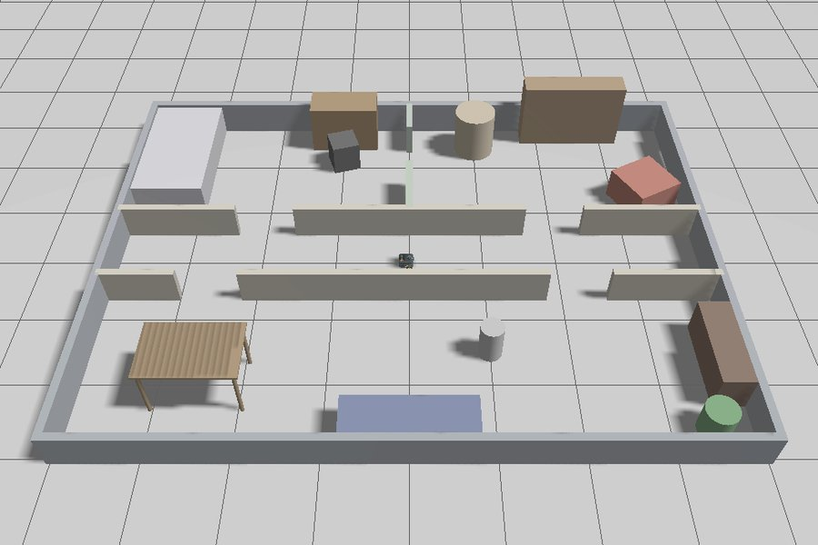
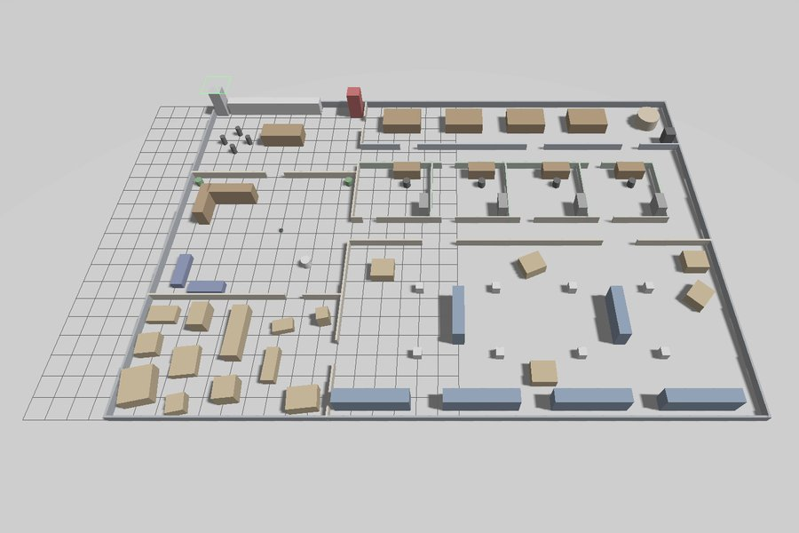
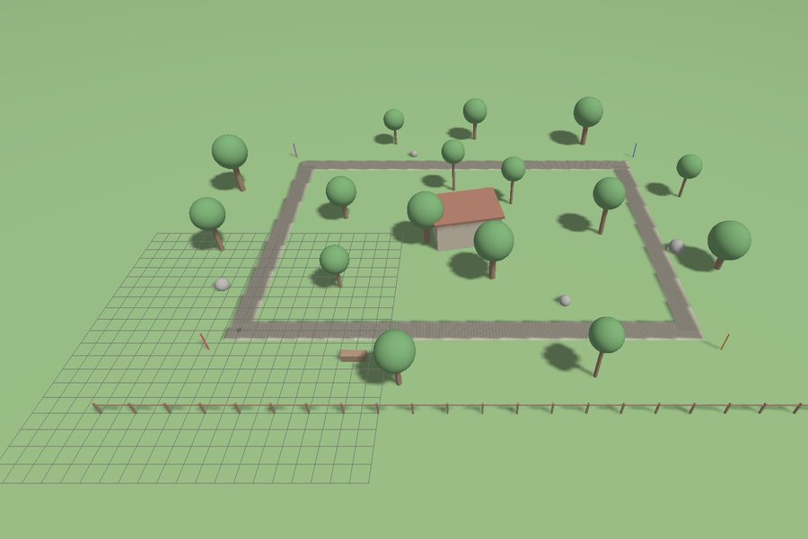

# Try Caretta

Install Caretta on your computer and drive it in Gazebo, step by step.

**Requirements:**

- Ubuntu 22.04
- <a href="https://docs.ros.org/en/humble/Installation.html" target="_blank" rel="noopener">ROS 2 Humble</a>

```{raw} html
<div class="fsr-note"><strong>Note:</strong> Using a different system? A Docker version will be available soon.</div>
```

## 1. Meet Caretta

Caretta is our first robot: a small, open source indoor robot that runs ROS 2.

```{raw} html
<div class="rln-viewer rb-viewer fsr-viewer" data-caretta-viewer data-caption="Drag to rotate, click and scroll to zoom."></div>
<script type="module" src="_static/caretta-viewer/caretta-viewer.js"></script>
```

| Part | Purpose |
|---|---|
| Two wheels | Differential drive, up to 0.3 m/s |
| 2D LiDAR | Sees the obstacles around the robot |
| IMU | Measures rotation for better localization |
| Camera | Shows what is in front |
| E-stop | Emergency stop button for safety |
| Current sensor | Measures battery current for the battery management system |

## 2. Install

First, install the tools we need:

```bash
sudo apt install python3-rosdep python3-colcon-common-extensions git \
  ros-humble-teleop-twist-keyboard
```

- `rosdep`: installs the dependencies
- `colcon`: builds the packages
- `git`: downloads the repos
- `teleop_twist_keyboard`: drives the robot with the keyboard

### 2.1 Download the repos

Create a workspace folder and go into its `src` folder:

```bash
mkdir -p ~/caretta_ws/src
cd ~/caretta_ws/src
```

Download the robot repo:

```bash
git clone -b humble https://github.com/field-stack-robotics/caretta.git
```

```{raw} html
<div class="fsr-bar" aria-hidden="true"><i></i><i></i><i></i></div>
<div class="fsr-term">
<span style="color:#3fd2c7">user@ubuntu</span>:<span style="color:#5fafff">~/caretta_ws/src</span>$ git clone -b humble https://github.com/field-stack-robotics/caretta.git<br>Cloning into &#x27;caretta&#x27;...<br>remote: Enumerating objects: 307, done.<br>remote: Counting objects: 100% (307/307), done.<br>remote: Compressing objects: 100% (156/156), done.<br>Receiving objects: 100% (307/307), 1.02 MiB | 2.13 MiB/s, done.<br>Resolving deltas: 100% (134/134), done.
</div>
```

Before downloading the simulation repo, make sure you are in the `src` folder:

```bash
cd ~/caretta_ws/src
```

Then download the simulation repo:

```bash
git clone -b humble https://github.com/field-stack-robotics/caretta_simulator.git
```

```{raw} html
<div class="fsr-bar" aria-hidden="true"><i></i><i></i><i></i></div>
<div class="fsr-term">
<span style="color:#3fd2c7">user@ubuntu</span>:<span style="color:#5fafff">~/caretta_ws/src</span>$ git clone -b humble https://github.com/field-stack-robotics/caretta_simulator.git<br>Cloning into 'caretta_simulator'...<br>remote: Enumerating objects: 97, done.<br>remote: Counting objects: 100% (97/97), done.<br>remote: Compressing objects: 100% (53/53), done.<br>Receiving objects: 100% (97/97), 169.23 KiB | 1.45 MiB/s, done.<br>Resolving deltas: 100% (38/38), done.
</div>
```

### 2.2 Build the workspace

Set up `rosdep`. You only need this once per computer, so skip it if it says "already exists":

```bash
sudo rosdep init
```

Go back to the workspace, update the package list and install everything the repos need:

```bash
cd ~/caretta_ws
rosdep update
rosdep install --from-paths src --ignore-src -y
```

Now, build the packages:

```bash
colcon build
```

```{raw} html
<div class="fsr-bar" aria-hidden="true"><i></i><i></i><i></i></div>
<div class="fsr-term">
<span style="color:#3fd2c7">user@ubuntu</span>:<span style="color:#5fafff">~/caretta_ws</span>$ colcon build<br>Starting &gt;&gt;&gt; caretta_control<br>Starting &gt;&gt;&gt; caretta_description<br>Starting &gt;&gt;&gt; caretta_localization<br>Starting &gt;&gt;&gt; caretta_rviz_plugins<br>Starting &gt;&gt;&gt; caretta_navigation<br><span style="color:#7ee787">Finished &lt;&lt;&lt;</span> caretta_control [1.00s]<br><span style="color:#7ee787">Finished &lt;&lt;&lt;</span> caretta_navigation [1.01s]<br><span style="color:#7ee787">Finished &lt;&lt;&lt;</span> caretta_localization [1.03s]<br><span style="color:#7ee787">Finished &lt;&lt;&lt;</span> caretta_description [1.05s]<br>Starting &gt;&gt;&gt; caretta_gazebo<br><span style="color:#7ee787">Finished &lt;&lt;&lt;</span> caretta_gazebo [0.71s]<br><span style="color:#7ee787">Finished &lt;&lt;&lt;</span> caretta_rviz_plugins [16.7s]<br>Starting &gt;&gt;&gt; caretta_navigation_outdoor<br><span style="color:#7ee787">Finished &lt;&lt;&lt;</span> caretta_navigation_outdoor [1.06s]<br><br>Summary: 7 packages finished [18.1s]
</div>
```

Finally, go to the workspace and source it so ROS 2 can find the packages:

```bash
cd ~/caretta_ws
source install/setup.bash
```

## 3. Start the simulation

### 3.1 Launch Gazebo

Start Gazebo and RViz with the house world:

```bash
ros2 launch caretta_gazebo gazebo.launch.py rviz:=true world:=caretta_house
```

```{raw} html
<div class="fsr-bar" aria-hidden="true"><i></i><i></i><i></i></div>
<div class="fsr-term">
<span style="color:#3fd2c7">user@ubuntu</span>:<span style="color:#5fafff">~/caretta_ws</span>$ ros2 launch caretta_gazebo gazebo.launch.py rviz:=true world:=caretta_house<br><span style="color:#7ee787">[INFO]</span> [ign gazebo-1]: process started<br><span style="color:#7ee787">[INFO]</span> [robot_state_publisher-2]: process started<br><span style="color:#7ee787">[INFO]</span> [parameter_bridge-3]: process started<br><span style="color:#7ee787">[INFO]</span> [image_bridge-4]: process started<br><span style="color:#7ee787">[INFO]</span> [rviz2-5]: process started<br><span style="color:#7ee787">[INFO]</span> [ekf_node-6]: process started<br>...<br>[create-7] <span style="color:#7ee787">[INFO]</span> [ros_gz_sim]: Requested creation of entity.<br>[create-7] <span style="color:#7ee787">[INFO]</span> [ros_gz_sim]: OK creation of entity.<br><span style="color:#7ee787">[INFO]</span> [twist_mux-9]: process started<br>[ign gazebo-1] <span style="color:#7ee787">[INFO]</span> [gz_ros2_control]: System Successfully configured!<br>[spawner-8] <span style="color:#7ee787">[INFO]</span> [spawner_joint_state_broadcaster]: Configured and activated joint_state_broadcaster<br>[spawner-8] <span style="color:#7ee787">[INFO]</span> [spawner_joint_state_broadcaster]: Configured and activated diff_drive_controller
</div>
```

You can also try the other worlds, `caretta_office` and `caretta_outdoor`:

```{raw} html
<table class="fsr-worlds"><tr>
<td align="center"><br><code>caretta_house</code></td>
<td align="center"><br><code>caretta_office</code></td>
<td align="center"><br><code>caretta_outdoor</code></td>
</tr></table>
```

### 3.2 Drive with the keyboard

Open a new terminal, source the workspace and start the keyboard teleop:

```bash
source ~/caretta_ws/install/setup.bash
ros2 run teleop_twist_keyboard teleop_twist_keyboard \
  --ros-args -r cmd_vel:=cmd_vel_teleop
```

```{raw} html
<div class="fsr-bar" aria-hidden="true"><i></i><i></i><i></i></div>
<div class="fsr-term">
<span style="color:#3fd2c7">user@ubuntu</span>:<span style="color:#5fafff">~</span>$ ros2 run teleop_twist_keyboard teleop_twist_keyboard --ros-args -r cmd_vel:=cmd_vel_teleop<br>Moving around:<br>&nbsp;  u&nbsp; &nbsp; i&nbsp; &nbsp; o<br>&nbsp;  j&nbsp; &nbsp; k&nbsp; &nbsp; l<br>&nbsp;  m&nbsp; &nbsp; ,&nbsp; &nbsp; .<br><br>q/z : increase/decrease max speeds by 10%<br>anything else : stop<br>CTRL-C to quit
</div>
```

`i` drives forward, `j` and `l` turn, `k` stops. Keep this terminal selected while you drive.

```{raw} html
<p align="center" class="fsr-img"><video src="_static/try/hero.mp4" aria-label="Caretta driving in Gazebo and RViz" width="760" autoplay loop muted playsinline></video></p>
```

```{raw} html
<div class="fsr-help"><strong>Having a problem?</strong> Ask us on <a href="https://discord.gg/NCBbzgu32" target="_blank" rel="noopener">Discord</a>.</div>
```

```{raw} html
<div class="fsr-page"></div>
<script src="_static/try-page.js" defer></script>
```
